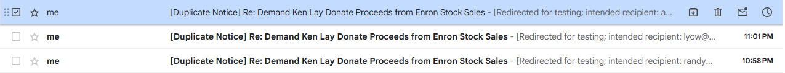

# AI tool usage

This file describes how AI tools were used to build this pipeline. It is based on the running log in [docs/ai_session_log.md](docs/ai_session_log.md) and the per-agent reports in [docs/agent_reports/](docs/agent_reports/). Every error quoted below is copied from those files.

---

## 1. Tool used

| Item | Value |
|---|---|
| Tool | Claude Code (Anthropic's CLI coding agent) |
| Version (`claude --version`) | Claude Code 2.1.328, model Claude Opus 5.5 (claude-opus-5-5) |
| Model | Claude Opus 5.5 (`claude-opus-5-5`) |
| Mode | One lead session plus parallel subagents (parser, db, dedup, notify, cli, mcp), each limited to its own files |
| MCP servers used from Claude Code | `descope-gmail` (Descope Gmail MCP, HTTP transport, OAuth via `/mcp`) |

---

## 2. Prompting strategy

**Full spec first, then task by task.** Before any code was written, I wrote a phased plan (`plan.md`) that turns the assignment into ten phases. Each phase has its file list, field rules, algorithm, tests, acceptance checks and commit message. Claude Code was given the whole plan up front, so every later prompt could be short ("run the next wave") without re-explaining the requirements. The plan also set ground rules that apply to every step: never crash on bad input, never commit secrets, never email a real Enron address, dry run by default, and log real failures honestly.

**Contracts before parallel work.** The plan has a "Wave 0" in which the lead agent writes the shared data types (`models.py`), `schema.sql`, `config.py`, `normalize.py` and typed stubs for every module. After that, five subagents worked in parallel (parser, db, dedup, notify, cli). Each could only edit its own files and had to write tests first from small hand-made fixtures. Each one wrote a report with the exact errors it hit. Fixing the interfaces first is what made parallel work safe.

**Checkpoints.** The plan stops for my confirmation at two points: after MCP discovery (which tool, which override address, how to supply the token) and before the first live email.

### Example prompts

| # | Prompt (verbatim) | Why it was structured this way |
|---|---|---|
| 1 | "can u read the plan.md first completely and discuss the plan and all the things that u will require prior to u running" | I wanted problems found before any code existed. This surfaced that no Descope MCP server was registered in Claude Code, and that only ~2 GB of 7.9 GB RAM was free (so workers were capped at 3). |
| 2 | "use another agent to download the dataset meanwhile" | The 443 MB download is slow but independent, so it ran in a background agent while MCP setup continued. |
| 3 | "use multiple agents to get the subtasks" | The plan already defined subagents with file ownership and contracts, so one short prompt was enough to start Wave 1 (five agents in parallel). |
| 4 | "/mcp … again ?" followed by several "check again" rounds | Short prompts after each re-authentication attempt, asking the agent to re-check the server after a fix, until the sign-in worked and `read_gmail_inbox` returned real messages. |
| 5 | Send prompt for the Claude-Code-driven path: "Read `output/send_queue.jsonl`, call `send_gmail_email` for each item with `to`/`subject`/`body`/`references`, then run `python main.py --record-send <message_id> --status sent`." After the first send: "yes send 2 more" | Keeps the send step in Claude Code, which already holds a valid Descope token, while the pipeline keeps the DB and log up to date through `--record-send`. |


---

## 3. Iterations and debugging

These are real cases where AI-generated code or setup did not work on the first attempt.

### Case 1: Descope rejected every sign-in (`iss` validation)

- **What happened.** After authenticating with `/mcp`, Claude Code reported `descope-gmail rejected them on reconnect`, every time.
- **Cause.** The MCP server used `@descope/node-sdk` `validateSession`. Descope agentic (MCP) tokens have an `iss` of the form `…/v1/apps/agentic/<project>/<mcp_server>`. `validateSession` requires the last path segment of the issuer to equal the project ID, so it threw `unexpected "iss" claim value`.
- **Fix.** Claude replaced the SDK call with JWT verification using WebCrypto against the project JWKS (RS256, `exp`/`nbf` with 5 s skew), with an issuer allow-list that includes the agentic issuer. The server was redeployed to Vercel.
- **How it was found.** Several rounds of "check again" after each re-authentication, then reading the token claims and the SDK's issuer check.

### Case 2: Gmail API errors were swallowed

- **What happened.** Once sign-in worked, `read_gmail_inbox` returned an empty list. Nothing looked wrong.
- **Cause.** The tool (adapted from Descope's sample) turned Gmail API errors into an empty result.
- **Fix.** The tool was changed to return `Error: Gmail API <status>: <message>`. The real error then appeared: `Gmail API 403: Gmail API has not been used in project … or it is disabled`. I enabled the Gmail API in Google Cloud, and the read returned 3 real messages.
- **Related setup errors found the same way** (after adding logging of Descope's error replies):
  - `E113301 "Fetching outbound app tokens is not allowed according to access control rules"`. Fixed by me in the Descope console (access rules on the `gmail` connection).
  - Google `Error 400: redirect_uri_mismatch`. Fixed by me by adding `https://api.descope.com/v1/outbound/oauth/callback` to the Google OAuth client.

### Case 3: A passing test hid a wrong value (8-bit subject decoding)

- **What happened.** The parser agent's first run had all 69 tests passing. But the assertion for a subject with raw 8-bit bytes was loose (`== ... or startswith("Caf")`). Inspecting the value showed `'Café \x93quotes\x94'`.
- **Cause.** The header was decoded as latin-1, which turns cp1252 smart quotes into C1 control characters.
- **Fix.** Header decoding now tries declared charset → UTF-8 → cp1252 → latin-1, and the test asserts the exact value `"Café “quotes”"`.
- **Follow-on failure.** While patching that test through a bash heredoc running Python `str.replace`, escape sequences were written as real characters, including a NUL byte. pytest failed collection with `ValueError: source code string cannot contain null bytes`. Fixed by rewriting the two lines with explicit escapes.

### Case 4: A valid email rejected as `missing_to` (the "the.desk" address)

- **What happened.** A read-only smoke test on 2,000 real emails reported 52 `missing_to` failures. 51 really had no `To:` header. The 52nd had `To: <"the.desk":@enron.com>`.
- **Cause.** The stdlib `getaddresses` split it into `'"the.desk"'` and `'@enron.com'`, and neither is a usable address.
- **Fix.** A pre-clean regex rewrites `"local":@domain` to `local@domain`, with a regression test. Failures went from 52 to 51.

### Case 5: Headings heuristic too noisy on real data

- **What happened.** The first headings rule passed the unit tests but matched 13.5% of the real sample. The top "headings" were `FYI` (43), `[IMAGE]` (11), `FYI.`, two-letter table cells like `AL`/`DP`/`OR`, salutations like `Daren:`, column-aligned table rows, and `To unsubscribe ..., go to:`.
- **Fix.** The rules were tightened: stop words, a minimum of 3 letters for one-word caps lines, exclusion of `[IMAGE]`/URLs/table rows, and no colon heading on the first line of the body. A regression test was built from these exact lines. Matches dropped to 6.1%, mostly real section titles such as `SUBSCRIPTION SERVICES` and `COMMITTEE STRUCTURE`.

### Smaller issues

- **Template repo did not exist.** `git clone https://github.com/descope/mcp-with-next-js-and-descope.git` gave `remote: Repository not found.` Claude listed `descope/ai` with `gh api repos/descope/ai/contents/examples`, found `examples/nextjs-vercel-mcp-server`, and sparse-cloned it.
- **Broken install.** `pnpm install` was started twice because the first looked stalled (buffered output). The second was killed mid-way, and the build failed with `Error: Cannot find module '...\node_modules\next\dist\bin\next'`. Fixed by deleting `node_modules` and running one clean `pnpm install --frozen-lockfile`.
- **Scratch script shadowed a stdlib module.** A probe named `inspect.py` caused `ImportError: cannot import name 'parse_file' from partially initialized module 'enron_pipeline.parser'`. Renamed it.
- **A test that tested nothing.** The dedup agent noticed that its workers=1 vs workers=2 test put all blocks in one batch, so no real distribution happened. The batch size is now read at call time, and the test lowers it so more than 2 batches are made.
- **Plan assumption out of date.** The plan used the MCP SDK 1.x name `streamablehttp_client`. The installed SDK is 2.3.0, which uses `streamable_http_client` with an `httpx2.AsyncClient` for headers. The MCP agent checked the installed package source before writing the client.
- **Windows filenames.** Every Enron file name ends in `.`, which Windows strips. The extractor writes `45.` as `45_`, and `source_file` maps it back.


---

## 4. What I wrote vs what AI wrote

The percentages count who physically wrote each part. The Notes column lists what I decided, set up or checked by hand.

| Area | Written by me (%) | Written by AI (%) | Notes (what I did by hand) |
|---|---|---|---|
| `plan.md` (phased spec) | 30% | 70% | Reviewed and edited the AI's draft. Set the phase order, the subset size, the laptop limits (3 workers, RAM pre-flight) and the stop-and-report-after-each-phase rule. |
| Parsing (`parser.py`, `body.py`, `addresses.py`, `dates.py`) | 5% | 95% | Reviewed output on real files. Raised edge cases from smoke runs, such as the `"the.desk"` address and noisy headings. |
| Database (`schema.sql`, `db.py`, `sample_queries.sql`) | 5% | 95% | Approved the normalized address-table design. Checked the sample-query results. |
| Dedup (`dedup.py`, `normalize.py`) | 10% | 90% | Decided the dedup rules: compare on forwarded content when the body is empty, earliest is the original, flag all later emails. Chose the rapidfuzz library. |
| Notices and sending (`notify.py`, `mcp_client.py`) | 10% | 90% | Chose 3 live sends redirected to my own Gmail instead of 15,317, plus the redirect banner. Approved each live send and granted the Gmail consent. |
| CLI, Makefile, dataset scripts | 5% | 95% | Picked the mailboxes. Ran the long runs and freed memory mid-run by closing VS Code. |
| Tests and fixtures | 5% | 95% | Reviewed failures. Pushed for exact-value assertions after a too-loose test passed with a bug. |
| Descope / Google Cloud console setup | 80% | 20% | Did all console work by hand: OAuth client, redirect URI fix, enabling the Gmail API, Descope access rules and scopes. The AI only diagnosed the errors and gave the steps. |
| MCP server (Next.js, `descope-gmail-mcp/`) | 5% | 95% | Chose Descope plus a custom server, and the Vercel deploy. The AI adapted Descope's sample to use Bearer-token auth. |
| Documentation (README, AI_USAGE) | 15% | 85% | Chose to mask my Gmail in the public repo. Took the live-send screenshot. Reviewed and edited the docs. |
| **Overall** | **~10%** | **~90%** | The AI wrote almost all of the code. My share was the decisions, the external-service setup, approvals, real-data checks and review. |

---

## 5. Lessons learned

- Giving the full plan up front, with file ownership and shared contracts, made parallel subagents practical. Five agents worked at once without editing each other's files.
- Green tests are not proof. The parser's first run passed while a subject was decoded wrongly, because the assertion was too loose. Exact-value assertions caught it.
- Real data finds problems that hand-made fixtures miss: the `"the.desk"` address and the noisy headings rule both showed up only in a smoke test on real files. A small read-only sample run before the full run was worth it.
- Error handling that hides errors cost the most time. The empty inbox result hid a disabled Gmail API. Making tools report errors as they are should come first.
- The MCP setup was harder than the data work. The issues were spread over Descope, Google Cloud and the server code, and several needed console changes that only I could make.
- The AI's knowledge of library APIs can be out of date (MCP SDK 1.x vs 2.3.0, the template repo name). Checking the installed package or the real repo first avoided wrong code.
- Process hygiene matters on a small machine: a duplicated install and a directory listing over 63k files both caused avoidable failures.

---

## 6. MCP integration

### Server chosen and why

I used a **Gmail MCP server behind the Descope Agentic Identity Hub**. The server is a Next.js app based on Descope's `descope/ai` sample (`examples/nextjs-vercel-mcp-server`), deployed on Vercel at `https://descope-gmail-mcp.vercel.app/api/mcp`, with two tools: `send_gmail_email(to, subject, body, references?)` and `read_gmail_inbox(max_results?)`. `send_gmail_email` is the `send_email` tool the assignment refers to (the pipeline finds it through `MCP_SEND_TOOL`). The assignment gave no list of servers to pick from, so the choice was free. The server's redacted configuration (env var names, console setup, code changes) is in [docs/mcp_server/](docs/mcp_server/README.md).

Reasons:
- **Google tokens never reach the agent.** Descope stores the Gmail OAuth tokens in a Connection. The MCP server asks Descope for a short-lived Gmail token on each call. Claude Code only holds an MCP access token.
- **Scoped access.** The MCP token carries agent-facing scopes (`google-read`, `google-send`), and the server asks for only the Gmail scope it needs per call (`gmail.readonly` or `gmail.send`).
- **Standard OAuth for MCP.** The Descope MCP server supports OAuth 2.1 with PKCE and dynamic client registration, which Claude Code's `/mcp` flow uses directly.
- Descope also offers per-email human approval (Enchanted Link), but **this server does not implement it**. Plain sending was set up first and approval was left out. Safety comes from the override address and the `--max-send` cap instead.

The Descope sample passed user identity in `_meta` for a custom Node agent. Claude Code and the Python MCP client send a Bearer token instead, so the tools were rewritten to take the user ID and token from `extra.authInfo` (set by `withMcpAuth`). An optional `references` argument was added, and a header-injection guard rejects line breaks in `to`, `subject` and `references`.

### Step-by-step setup

1. **Google Cloud.** Create an OAuth web client. Add `https://api.descope.com/v1/outbound/oauth/callback` as an authorized redirect URI. Enable the Gmail API.
2. **Descope Connection.** In the Descope console, create a Google outbound app / Connection with id `gmail` and the scopes `gmail.readonly` and `gmail.send`. Set its access rules so the MCP server is allowed to fetch tokens (otherwise you get `E113301`).
3. **Descope MCP Server.** In the Agentic Identity Hub, create an MCP Server and define the scopes `google-read` and `google-send` mapped to the Gmail scopes.
4. **Deploy the MCP server.** Configure the Next.js app with the Descope project ID, MCP server ID and `GMAIL_CONNECTION_ID=gmail`, and deploy it to Vercel. Check `GET /.well-known/oauth-protected-resource`.
5. **Register with Claude Code.** `claude mcp add --transport http --scope user descope-gmail https://<your-mcp-host>/api/mcp`, then `/mcp` → `descope-gmail` → authenticate in the browser.
6. **Connect Gmail.** The first tool call may return `insufficient_scope` with an `authorization_url`. Open it once to grant Gmail access through Descope, then retry.
7. **Verify.** Ask Claude Code to call `read_gmail_inbox`. It returned 3 real messages.
8. **Project config.** Copy `.env.example` to `.env` and set `NOTIFY_OVERRIDE_TO` (plus `DESCOPE_MCP_URL` and `DESCOPE_MCP_ACCESS_TOKEN` for the Python client path). `mcp_config.json.example` shows the server entry in `.mcp.json` format with placeholders only.

Full details (token claims, endpoints, result shapes, IDs redacted) are in [docs/mcp_discovery.md](docs/mcp_discovery.md).

### How Claude Code was prompted to use the send tool

The pipeline can send in two ways. The Python client (`--send-live`) needs a token outside Claude Code, and the token Claude Code holds cannot be exported in a supported way. So the main path is Claude-Code-driven:

1. `python main.py --send-live --via-claude-code --max-send 3` writes `output/send_queue.jsonl` (to = override address, subject, body with the redirect line, References) and stops.
2. Prompt to Claude Code (prepared template):

   > Read output/send_queue.jsonl. For each item, call the descope-gmail send_gmail_email tool with the given to, subject, body and references. After each call, run `python main.py --record-send <message_id> --status <status> [--error "<text>"]`.

3. Prompt actually used (Claude Code acting as the MCP client, recorded in [docs/ai_session_log.md](docs/ai_session_log.md)):

   > Read output/send_queue.jsonl, call send_gmail_email for each item with to/subject/body/references, then run `python main.py --record-send <message_id> --status sent`.

   I approved the first send, and after it arrived I approved the rest with "yes send 2 more".

`--record-send` sets `notification_sent` and `notification_date` in the DB and appends a row to `output/send_log.csv`.

### Where the live notices went, and why

- **Redirected to my own address.** All live notices went to `NOTIFY_OVERRIDE_TO` (my own Gmail), not to the Enron sender the assignment names. The senders are real people's addresses from a public dataset, and sending them test mail would be wrong. The first body line is a banner, `[Redirected for testing; intended recipient: <enron sender>]`, and the intended recipient is also logged in the `intended_recipient` column of `send_log.csv`.
- **Capped at 3.** Only 3 live notices were sent (`--max-send 3`, the latest duplicate of the first 3 groups). The assignment needs at least one successful live send. Sending one per group (thousands) to one inbox would only be spam and would risk Gmail rate limits on the account.
- **Everything else follows the template.** The dry-run `.eml` files (one per flagged duplicate) carry the exact template addressed to the real sender. A live copy differs only in its `To:` address, the banner line, and the `Date:` header that Gmail sets at send time.

### Issues during MCP setup and sending

| Issue (exact error) | Resolution |
|---|---|
| `git clone https://github.com/descope/mcp-with-next-js-and-descope.git` → `remote: Repository not found.` | Found the real sample in `descope/ai` (`examples/nextjs-vercel-mcp-server`) and sparse-cloned it. |
| `Error: Cannot find module '...\node_modules\next\dist\bin\next'` after a killed second `pnpm install` | Deleted `node_modules`, ran one clean `pnpm install --frozen-lockfile`. |
| Claude Code: `descope-gmail rejected them on reconnect`; server: `unexpected "iss" claim value` | Replaced `validateSession` with WebCrypto JWT verification and an issuer allow-list including the agentic issuer. |
| `E113301 "Fetching outbound app tokens is not allowed according to access control rules"` | Changed the access rules on the `gmail` Connection in the Descope console. |
| Google `Error 400: redirect_uri_mismatch` | Added the Descope outbound callback URL to the Google OAuth client. |
| Empty inbox, then `Gmail API 403: Gmail API has not been used in project … or it is disabled` | Made the tool report Gmail errors; enabled the Gmail API. |
| Plan assumed MCP SDK 1.x `streamablehttp_client`; installed SDK is 2.3.0 | Client written against the 2.x API (`streamable_http_client` with an `httpx2.AsyncClient`). |
| The MCP tool cannot set a `Date` header | Gmail sets `Date` at send time; the original dates are in the body, as the template already shows. |
| No way to get an MCP access token outside Claude Code for the Python client | Used the `--send-live --via-claude-code` path: the pipeline writes `output/send_queue.jsonl`, Claude Code calls the tool, and `--record-send` updates the DB and `send_log.csv`. |
| First live `send_gmail_email` call returned `{"error":"insufficient_scope", ...}` with a Google consent URL for `gmail.send` (the earlier Gmail connection had been used only for reading) | I opened the URL and approved the `gmail.send` consent through Descope. The retry of the same item returned `{"status":"sent"}`. Sends 2 and 3 then returned `sent` on the first try. |

### Successful live send

3 notices were sent and all 3 returned `sent`. `output/send_log.csv` has 3 `status=sent` rows, all to my own address, and the DB has `notification_sent = 1` for those three duplicates.

Screenshot of the received notice: `docs/screenshots/live_send.png`



Excerpt from `output/send_log.csv`:

```csv
timestamp,recipient,subject,status,error,intended_recipient,message_id
2026-11-19T03:59:44+00:00,a***@gmail.com,[Duplicate Notice] Re: Demand Ken Lay Donate Proceeds from Enron Stock Sales,sent,,randymonk@hotmail.com,<18188947.1075860811513.JavaMail.evans@thyme>
2026-11-19T04:01:50+00:00,a***@gmail.com,[Duplicate Notice] Re: Demand Ken Lay Donate Proceeds from Enron Stock Sales,sent,,lyow@indiana.edu,<19076571.1075860812689.JavaMail.evans@thyme>
2026-11-19T04:01:51+00:00,a***@gmail.com,[Duplicate Notice] Re: Demand Ken Lay Donate Proceeds from Enron Stock Sales,sent,,aprilhoover@msn.com,<5697724.1075860813887.JavaMail.evans@thyme>
```
