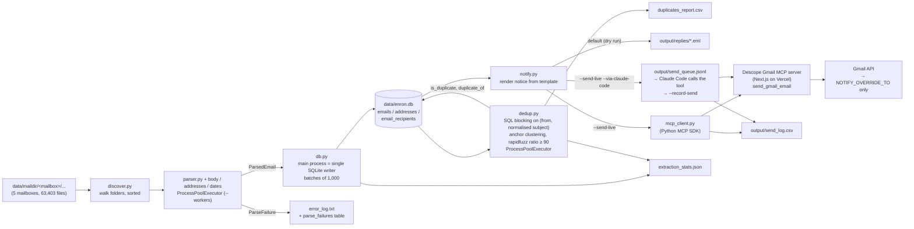

# Enron email extraction, dedup and MCP notification pipeline

This project parses raw Enron emails (RFC 2822 files) into a normalised SQLite database, finds near-duplicate emails with fuzzy matching, writes a duplicates report, and produces a duplicate notice for every flagged email. Notices are written as `.eml` files by default (dry run). With `--send-live`, a small number of them are sent through a Gmail MCP server hosted behind the Descope Agentic Identity Hub.

One command runs the whole pipeline end to end: `make run` (or `python main.py --fresh` on Windows without `make`).

How AI tools were used to build it is documented in [AI_USAGE.md](AI_USAGE.md).

---

## Architecture



| Stage | Module | Output |
|---|---|---|
| Discover | `src/enron_pipeline/discover.py` | sorted list of files |
| Parse | `parser.py`, `body.py`, `addresses.py`, `dates.py` | `ParsedEmail` or `ParseFailure` per file |
| Load | `db.py`, `stats.py` | `data/enron.db`, `error_log.txt`, `extraction_stats.json` |
| Dedup | `dedup.py`, `normalize.py` | flags in the DB, `duplicates_report.csv` |
| Notify | `notify.py`, `mcp_client.py` | `output/replies/*.eml`, `output/send_log.csv` |
| CLI | `main.py`, `Makefile` | one command for everything |

Parsing runs in a process pool because it is CPU-bound and every file is independent. Only the main process writes to SQLite, because SQLite allows one writer at a time. Dedup blocks are also independent, so they are spread over a second process pool, biggest blocks first. The default worker count is `min(3, cpu_count - 1)`, capped at 3 because the development machine has 8 GB of RAM.

---

## Setup

### 1. Python environment

Python 3.11+ is required (the MCP client uses `BaseExceptionGroup`, which was added in 3.11); the project was built and tested on **Python 3.11**.

```bash
make setup
```

Without `make` (Windows PowerShell):

```powershell
py -3.11 -m venv .venv
.venv\Scripts\python.exe -m pip install --upgrade pip
.venv\Scripts\python.exe -m pip install -r requirements.txt
```

Dependencies (`requirements.txt`, all free/open source): `rapidfuzz`, `python-dateutil`, `tqdm`, `mcp` (official MCP Python SDK, 2.3.0), `python-dotenv`, `httpx2` (HTTP client used by the MCP client), `pytest`. Parsing uses the standard library `email` package.

### 2. Dataset

```bash
make download        # or: .venv\Scripts\python.exe scripts/download_dataset.py
make sizes           # or: .venv\Scripts\python.exe scripts/mailbox_sizes.py
```

`scripts/download_dataset.py` downloads `enron_mail_20150507.tar.gz` (443,254,787 bytes) from CMU into `data/`, with resume support and a size check, and then extracts only the selected mailboxes into `data/maildir/` in one streaming pass. `main.py` also runs this check automatically and only downloads if a selected mailbox folder is missing or empty.

**Windows filename issue.** Every Enron file name ends in a dot (for example `maildir/lay-k/inbox/45.`). Windows silently strips trailing dots, which can make files collide or disappear. The extractor therefore writes them as `45_`. `discover.relative_source` maps the name back, so `source_file` in the database is still `maildir/lay-k/inbox/45`, as the assignment asks. The extractor also rejects unsafe tar member paths itself (absolute paths, `..`, drive letters), because `tarfile`'s `filter="data"` is not available in Python 3.11.0.

### 3. Environment file

Copy `.env.example` to `.env` and fill it in. `.env` is gitignored and never committed.

| Variable | Used for |
|---|---|
| `NOTIFY_OVERRIDE_TO` | **Required for any live send.** Every live notice goes to this address (your own Gmail). |
| `DESCOPE_MCP_URL` | MCP endpoint, e.g. `https://<your-mcp-host>/api/mcp` (Python client path) |
| `DESCOPE_MCP_ACCESS_TOKEN` | Bearer token for the MCP server (Python client path) |
| `MCP_SEND_TOOL` | Name of the send tool, default `send_gmail_email` |
| `DESCOPE_PROJECT_ID`, `DESCOPE_MCP_SERVER_ID`, `DESCOPE_CLIENT_ID`, `DESCOPE_CLIENT_SECRET` | Descope identifiers (optional, for reference) |

---

## MCP setup (Descope Gmail MCP)

The Gmail MCP server has three parts. Full details, with IDs redacted, are in [docs/mcp_discovery.md](docs/mcp_discovery.md). The server-side configuration (env var names with placeholders, Descope and Google Cloud console setup, and the changes made to the Descope sample) is in [docs/mcp_server/](docs/mcp_server/README.md).

1. **Descope Connection** (id `gmail`). A Google OAuth outbound app inside Descope. It holds the user's Google tokens with the scopes `gmail.readonly` and `gmail.send`. The agent never sees these tokens.
2. **Descope MCP Server** (Agentic Identity Hub). Issues MCP access tokens through OAuth 2.1 (authorization code + PKCE, dynamic client registration) and maps the agent-facing scopes `google-read` / `google-send` to the Gmail scopes.
3. **The MCP server itself.** A Next.js app based on Descope's `descope/ai` sample (`examples/nextjs-vercel-mcp-server`), deployed on Vercel at `https://descope-gmail-mcp.vercel.app/api/mcp`. Its source is a separate project (`../descope-gmail-mcp`); its redacted configuration is in [docs/mcp_server/](docs/mcp_server/README.md). It exposes two tools:
   - `send_gmail_email(to, subject, body, references?)`. `references` sets both `References` and `In-Reply-To`. This is the `send_email` tool the assignment refers to; the pipeline finds it through `MCP_SEND_TOOL` (default `send_gmail_email`).
   - `read_gmail_inbox(max_results?)`.

   For each call, the server verifies the MCP token, asks Descope for a Gmail token with the needed scope, and calls the Gmail API.

### Register it with Claude Code

```bash
claude mcp add --transport http --scope user descope-gmail https://<your-mcp-host>/api/mcp
```

Then run `/mcp` inside Claude Code, choose `descope-gmail` and authenticate in the browser. Claude Code stores the OAuth token itself. The first send or read may return `insufficient_scope` with an `authorization_url`; open it once to connect Gmail through Descope, then retry.

[`mcp_config.json.example`](mcp_config.json.example) shows the same entry in Claude Code `.mcp.json` format, with a placeholder URL and `Bearer ${DESCOPE_MCP_ACCESS_TOKEN}`. The real `.mcp.json` / `mcp_config.json` are gitignored.

### Setup issues hit (summary)

| # | Symptom | Fix |
|---|---|---|
| 1 | Every sign-in rejected on reconnect. `@descope/node-sdk` `validateSession` threw `unexpected "iss" claim value`, because agentic tokens have an `iss` ending in the MCP server ID, not the project ID. | Server now verifies the JWT with WebCrypto against the project JWKS, with an issuer allow-list that includes the agentic issuer. |
| 2 | `E113301 "Fetching outbound app tokens is not allowed according to access control rules"` | Changed the access rules on the `gmail` Connection in the Descope console. |
| 3 | Google `Error 400: redirect_uri_mismatch` | Added `https://api.descope.com/v1/outbound/oauth/callback` to the Google OAuth client's redirect URIs. |
| 4 | Inbox read returned an empty list. The tool was swallowing Gmail API errors; the real error was `Gmail API 403: Gmail API has not been used in project … or it is disabled`. | Enabled the Gmail API in Google Cloud; the tool now returns `Error: Gmail API <status>: <message>`. |

---

## How to run

| What | `make` | Plain Python (Windows) |
|---|---|---|
| Full dry-run pipeline on a fresh DB | `make run` | `.venv\Scripts\python.exe main.py --fresh` |
| Live notices (Python MCP client) | `make run-live` | `.venv\Scripts\python.exe main.py --send-live --max-send 3` |
| Tests | `make test` | `.venv\Scripts\python.exe -m pytest -q` |
| Mailbox file counts | `make sizes` | `.venv\Scripts\python.exe scripts/mailbox_sizes.py` |
| Remove generated files (keeps `data/` and deliverables) | `make clean` | see the `clean` target in `Makefile` |

**Dry run is the default.** A run without `--send-live` never contacts the MCP server. It writes one `.eml` per flagged duplicate to `output/replies/`.

**Re-runs.** On a fresh checkout (no `data/enron.db` yet), plain `python main.py` runs the whole pipeline. Once the DB holds emails, plain `python main.py` refuses to run and exits 2, so a second run cannot re-insert every row as an "exact duplicate" and overwrite `extraction_stats.json` with skewed numbers. Pick one:
- `--fresh`: drop the DB and re-extract everything (what `make run` does).
- `--skip-extract`: keep the extracted emails and only re-run dedup, the report and the `.eml` output.

**Send state survives re-runs.** After every dedup (with `--fresh` or `--skip-extract`) and before any live send, the pipeline restores `notification_sent` / `notification_date` from the `status=sent` rows in `output/send_log.csv`. The `--via-claude-code` queue also leaves out ids already logged as `sent`. So `make run` followed by `make run-live` never sends the same notice twice. `--send-live` works on the existing DB and does not re-run extraction.

### Live sending, two ways

**A. Python MCP client** (`--send-live`). Needs `NOTIFY_OVERRIDE_TO`, `DESCOPE_MCP_URL` and `DESCOPE_MCP_ACCESS_TOKEN` in `.env`. `mcp_client.py` opens a short MCP session per send, checks that the tool exists, and calls it.

**B. Claude Code drives the send** (`--send-live --via-claude-code`). Use this when you have no access token outside Claude Code (the token Claude Code holds cannot be exported in a supported way).

```powershell
.venv\Scripts\python.exe main.py --send-live --via-claude-code --max-send 3
```

This writes `output/send_queue.jsonl` and stops. Each line has `message_id`, `to` (already the override address), `intended_recipient`, `subject`, `body` and `headers.References`. Then ask Claude Code, for example:

> Read output/send_queue.jsonl. For each item, call the descope-gmail send_gmail_email tool with the given to, subject, body and references. After each call, run `.venv\Scripts\python.exe main.py --record-send <message_id> --status <status> [--error "<text>"]`.

`--record-send` updates the DB (`notification_sent`, `notification_date`) and appends to `output/send_log.csv` in the same way as path A.

### Main flags

| Flag | Meaning |
|---|---|
| `--maildir PATH` | folder that holds the mailbox folders (default `data/maildir`) |
| `--mailboxes a,b,c` | comma-separated mailbox names (default: the five below) |
| `--db PATH` | SQLite file (default `data/enron.db`) |
| `--fresh` | drop and recreate the DB first (needed, or `--skip-extract`, when the DB already has emails) |
| `--limit N` | dev only: parse the first N files |
| `--workers N` | worker processes for parsing and dedup |
| `--skip-extract` / `--skip-dedup` | reuse the existing DB / skip dedup, report and `.eml` output |
| `--send-live`, `--max-send N` | live sends, capped at N (default 3) |
| `--via-claude-code` | with `--send-live`: write the send queue and stop |
| `--record-send ID --status S [--error T]` | record the outcome of a Claude-Code-driven send |
| `-v` | debug logging and full tracebacks |

A failing stage prints `error: [stage] ExcType: msg` and exits 1. Bad flag combinations, and a plain run on a populated DB, exit 2.

---

## Safety

- **No email ever goes to a real Enron address.** Every live notice is sent to `NOTIFY_OVERRIDE_TO`. The first body line is `[Redirected for testing; intended recipient: <enron sender>]`, and the intended recipient is also logged in `send_log.csv`.
- `--send-live` and `--record-send` refuse to run if `NOTIFY_OVERRIDE_TO` is unset or blank. The check happens before the DB is opened.
- Live sends are capped by `--max-send` (default 3) and only target the latest duplicate of each group that has not yet been notified. Re-running never resends an item already marked `notification_sent = 1`, and that flag is restored from `output/send_log.csv` after a `--fresh` rebuild.
- The MCP server rejects line breaks in `to`, `subject` and `references` (header injection guard).
- Secrets (`.env`, real MCP config, tokens, client secret) are gitignored. Only `*.example` files are committed.

---

## Mailbox selection

| Mailbox | Files | Why |
|---|---:|---|
| `lay-k` (Kenneth Lay, chairman/CEO) | 5,937 | Executive mail: many forwards, announcements, mass mailings. |
| `skilling-j` (Jeff Skilling, CEO) | 4,139 | Executive mail, often sent by assistants; mixed formats. |
| `kaminski-v` (Vince Kaminski, research) | 28,465 | Largest box; long technical threads, many forwards, attachments, many folders. |
| `farmer-d` (Daren Farmer, gas logistics) | 13,032 | Operational mail with tables, repeated reports and near-identical messages. |
| `beck-s` (Sally Beck, operations) | 11,830 | Management mail with many cc lists and repeated status emails. |
| **Total** | **63,403** | Well above the 10,000 minimum. |

The set mixes executives and operations staff, small and large boxes, and a range of email styles (forwards, quoted replies, tables, attachment references). The larger boxes have the same message stored in several folders, which is a good test for duplicate detection.

---

## Database schema

`schema.sql` (SQLite, `PRAGMA foreign_keys = ON`):

| Table | Contents |
|---|---|
| `emails` | one row per parsed email: mandatory fields, optional `x_*` headers, `content_type`, `has_attachment`, `forwarded_content`, `quoted_content`, `headings`, `mailbox`, `normalized_subject`, plus dedup and notification columns `is_duplicate`, `duplicate_of` (FK to `emails.message_id`), `similarity_score`, `is_primary_target`, `notification_sent`, `notification_date` |
| `addresses` | one row per distinct address; `is_smtp = 0` for Exchange `/o=...` values |
| `email_recipients` | link table `(email_id, address_id, recipient_type in to/cc/bcc, position)` |
| `parse_failures` | `source_file`, `stage` (read/parse/validate/insert), `reason` |
| `duplicate_groups` | one row per original, with group size |

- `message_id` and `source_file` are `UNIQUE`. Inserts use `ON CONFLICT(message_id) DO NOTHING`, and exact Message-ID repeats are counted as `exact_duplicates_skipped`.
- Indexes: `date_utc`, `from_address`, `subject`, `normalized_subject`, `is_duplicate`, `duplicate_of`, `email_recipients.address_id`.
- Dates are stored as ISO-8601 UTC text, so text comparison gives chronological order.

**Assignment field names → database columns.** Most fields keep their assignment name. The exceptions:

| Assignment field (3.1 / 3.2) | Where it is stored |
|---|---|
| `message_id` | `emails.message_id` (`UNIQUE`) |
| `date` | `emails.date_utc` (ISO-8601 UTC; this is the "index on date") |
| `from_address` | `emails.from_address` |
| `to_addresses` | `email_recipients` rows with `recipient_type = 'to'` → `addresses.email` |
| `cc_addresses` | `email_recipients` rows with `recipient_type = 'cc'` → `addresses.email` |
| `bcc_addresses` | `email_recipients` rows with `recipient_type = 'bcc'` → `addresses.email` |
| `subject`, `body`, `source_file` | `emails.subject`, `emails.body`, `emails.source_file` |
| `x_from`, `x_to`, `x_cc`, `x_bcc`, `x_folder`, `x_origin` | same-named columns on `emails` |
| `content_type`, `has_attachment` (0/1), `forwarded_content`, `quoted_content`, `headings` | same-named columns on `emails` |
| `is_duplicate`, `duplicate_of`, `notification_sent`, `notification_date` | same-named columns on `emails` |

Recipients keep their header order in `email_recipients.position`.

**Why `from_address` stays on `emails` while to/cc/bcc are normalised.** Every email has exactly one sender, so it is a single value, not a list. Keeping it as a column allows the index the assignment asks for, and the dedup blocking key `(from_address, normalized_subject)` is a plain indexed `GROUP BY`. Recipients are lists of any length, so they go into `email_recipients` instead of comma-separated strings.

`sample_queries.sql` has six queries with expected output: emails per sender, emails in a date range, emails with CC recipients, all recipients of one message, a duplicate overview, and an optional-field completeness check.

---

## Parsing decisions

**Mandatory fields.** Checks run in the order Message-ID → Date → From → To → Subject, and the first missing field fails the file with reasons like `missing_to` or `bad_date: ...`. Failures go to `error_log.txt` (`path | stage | reason`) and the `parse_failures` table. No exception stops the run: read errors, parse errors and insert errors are all caught per file. Most failures are `missing_to`: calendar items, contacts and drafts that have no `To:` header at all.

**Mandatory `subject` and `body`: present but possibly empty.** "Mandatory" is read as "the field must exist", not "it must be non-empty":
- **Subject.** A missing `Subject:` header is a failure (`missing_subject`). A `Subject:` header that is present but empty is accepted and stored as `""`, because many real emails have no subject.
- **Body.** Every parsed email gets a `body` value. If the message has no text part at all, or the text that is left after splitting off forwarded and quoted content is empty, `body` is stored as `""` (never NULL), and the forwarded or quoted text stays in its own column. This is common for plain forwards with no comment; those rows are counted as `empty_body_with_forward`.
- The Results table reports the share of non-empty subjects and bodies separately.

**Header decoding.** RFC 2047 encoded words are decoded. Raw 8-bit header bytes are tried as declared charset → UTF-8 → cp1252 → latin-1. cp1252 comes before latin-1 because latin-1 turns Windows smart quotes into control characters. Folded (multi-line) headers are unfolded.

**Addresses.** Only the address is kept, lowercased; display names are dropped (they are in `x_from`, `x_to` etc.). The parser handles Enron oddities such as `<.name@enron.com>`, `'jeff'@enron.com`, `e-mail <.'john.doe'@enron.com>` and `<"the.desk":@enron.com>` (→ `the.desk@enron.com`). Exchange values like `/O=ENRON/OU=...` are kept with `is_smtp = 0`. Tokens without `@` (for example `undisclosed-recipients:;`) are dropped. Duplicates in one header are removed, keeping order.

**Dates.** The `(PDT)`-style comment is removed. If the remaining text has no zone, a zone abbreviation from the comment is used. Supported abbreviations: PST/PDT, MST/MDT, CST/CDT, EST/EDT, GMT/UT/UTC/Z, plus numeric offsets. The stdlib parser is tried first, then `dateutil` in fuzzy mode. A date with no zone at all is assumed to be US Pacific (-0800, the zone most Enron `Date:` headers use) and counted in `date_tz_assumed`. All dates are stored in UTC.

**Body splitting** (`body.py`). The decoded text body (multipart `text/plain` parts joined, or tag-stripped HTML as a fallback) is split into three parts:
- `forwarded_content`: from the first marker line to the end. Markers: `-----Original Message-----`, `---- Forwarded by`, `--- Forwarded Message ---`, `Begin forwarded message:`, or an Outlook block (a `From:` line followed within 4 lines by `Sent:`/`To:`/`Subject:`). Nested forwards stay inside forwarded content.
- `quoted_content`: lines starting with `>` and `On ... wrote:` lead-ins.
- `body`: what is left. It can be empty when someone forwarded a message with no comment; such rows are valid and counted as `empty_body_with_forward`.

**Headings heuristic.** A heading is a short line (≤ 80 characters, ≤ 10 words) that is either ALL CAPS, underlined with `===`/`---`, numbered (`1.`, `IV.`, `A)` + Title Case), or ends with `:` and is followed by text. Header-like lines, URLs, `@`, `[IMAGE]`, quoted lines and column-aligned table rows are excluded. So are stop words like `FYI` and `THANKS`, one-word caps lines under 3 letters (table cells such as `AL`), and a colon line that is the first line of the body (usually a salutation such as `Daren:`). The first version matched 13.5% of a 2,000-email sample, mostly noise; these filters brought it to 6.1%, mostly real section titles.

**Attachments.** `has_attachment` is true when a MIME part has `Content-Disposition: attachment` or a filename. It is also true when the text references a file: `<<budget.xls>>`, `<< File: ... >>`, a ` - name.ext` line, or a `.doc/.xls/.ppt/.pdf/.zip` name within 200 characters of the word "attach". Most Enron attachments were removed from the dataset, so text references are the main signal.

---

## Duplicate detection

A duplicate (per the assignment) has the same `from_address`, the same subject after removing `Re:`/`Fwd:` prefixes, and a body at least 90% similar.

1. **Normalise.** `normalized_subject` strips leading `Re:`, `Fw:`, `Fwd:`, `Aw:`, `Re[2]:` and `[Fwd: ...]` repeatedly, collapses whitespace and casefolds. Bodies are casefolded and whitespace-collapsed. Normally only the primary `body` is compared, not forwarded or quoted content.
2. **Empty bodies fall back to the forward.** An email whose normalised `body` is empty (typically a plain forward with no comment) is compared on its normalised `forwarded_content` instead, so a forward sent twice is still detected. These rows are counted as `compared_on_forwarded`. Each row is compared on its own text: a row that has a body never switches to its forward, so a body-only row and a forward-only row match only if body vs forward is at least 90% similar. A row is excluded only when **both** `body` and `forwarded_content` are empty, because otherwise every such email with the same sender and subject would be a "100% match". Those are counted as `excluded_empty_body`.
3. **Block in SQL** on `(from_address, normalized_subject)`. Only blocks with 2 or more members are compared, so the work is far smaller than all pairs.
4. **Anchor clustering inside each block.** Members are sorted by `(date_utc, id)`. Each email is compared only with the *original* (earliest member) of each existing cluster using `rapidfuzz.fuzz.ratio`, and joins the first cluster scoring ≥ 90; otherwise it starts a new cluster. So `similarity_score` is always measured against the original, and there is no chaining (A~B and B~C does not pull in a C that is < 90 against A).
5. **Prune.** A pair is skipped when the length ratio makes 90 impossible (`2*min(len)/(len_a+len_b)*100 < 90`), and `score_cutoff=90` lets rapidfuzz stop early.
6. **Flag.** In each cluster of 2 or more: the earliest is the original. Every other member gets `is_duplicate = 1`, `duplicate_of = <original message_id>` and its score. The latest member is the **primary target** for notification (`is_primary_target = 1`). All flagged emails appear in `duplicates_report.csv` and get a dry-run `.eml`.
7. **Parallel and deterministic.** Blocks are packed into batches of about 2,000 members, biggest first, and run in a process pool. Results are sorted, so any `--workers` value gives the same output; a test checks this.

`duplicates_report.csv` has exactly the 7 required columns, in this order: `duplicate_message_id, original_message_id, subject, from_address, duplicate_date, original_date, similarity_score`. `is_primary_target` is not in the CSV; it stays in the `emails` table (see `sample_queries.sql`).

**Why 90.** It is the assignment's threshold. Tests confirm that a body at 92% similarity is flagged and one at 85% is not. A high threshold matters here because blocking already guarantees the same sender and subject: recurring emails such as daily reports share both and much of their text, so a lower threshold would start merging different reports. Copies of the same message score close to 100.

**Why there are so many groups.** Enron mailboxes store the same message in several folders (`all_documents`, `sent`, `sent_items`, `discussion_threads`, `_sent_mail`), and each copy has its own Message-ID. Those copies are identical, so they are correctly grouped as duplicates. Most groups come from this folder copying, not from people sending the same email twice. Exact Message-ID repeats are a different thing: they are rejected at insert and counted separately.

**Why rapidfuzz.** MIT licensed, a C++ core (much faster than pure-Python `difflib` or `fuzzywuzzy`), `fuzz.ratio` gives the normalised Levenshtein similarity on a 0-100 scale that matches "90% similar" directly, and `score_cutoff` allows early exit.

---

## Notices

Each notice follows the assignment template character for character; a golden-file test checks this. Details:
- Subject: `[Duplicate Notice] Re: <original subject>`. The original subject's own `Re:`/`Fwd:` prefixes are stripped first, to avoid `Re: Re:`.
- The body `Subject:` line shows the duplicate's subject as stored.
- Dates are shown in RFC 2822 format in UTC, for example `Mon, 14 May 2001 23:39:00 +0000`. The similarity is shown with one decimal.
- Dry-run files are named after a sanitised Message-ID (`[A-Za-z0-9._-]`), with a hash suffix on collisions or Windows reserved names.

`output/send_log.csv` columns: `timestamp, recipient, subject, status, error, intended_recipient, message_id`.

---

## Known limitations

- **No `Date` header control in live sends.** The MCP tool accepts only `to`, `subject`, `body` and `references`. Gmail sets `Date`, `From` and `Message-ID` itself. The dry-run `.eml` files do have a `Date` header; live emails get Gmail's send time, which is the current timestamp the template asks for anyway.
- **No per-email human approval on this server.** Descope supports an Enchanted Link approval step, but this server does not implement it, so a send with a valid grant goes out immediately. The pipeline relies on the override address and `--max-send` instead. The client still handles a `NEEDS_APPROVAL` reply in case the server adds it.
- **Token for the Python client.** The token Claude Code holds cannot be exported in a supported way. The Python path needs a token in `DESCOPE_MCP_ACCESS_TOKEN` from your own OAuth + PKCE flow, and it expires. `--via-claude-code` is the practical path.
- **Heuristics.** Body splitting, headings and attachment detection are rule-based. Known misses: a salutation that is not on the first line (for example `Sally:` after a forwarded block) and short ALL-CAPS name lines can still be taken as headings.
- **Unknown time zones.** Abbreviations outside the list above (for example `CET`) are treated as "no zone" and assumed Pacific.
- **Emails without a `To:` header are rejected**, as the assignment's mandatory-field rule requires, even though some are real items (calendar entries, drafts).
- **Placeholder 1980-01-01 dates.** Some Enron messages carry a bogus `Date:` of 1 January 1980 (a client clock or import default), which is parsed and stored as is. Because the earliest member of a group is the original, such a copy becomes the "original" even if it was really filed later. 26 rows in `duplicates_report.csv` have an `original_date` or `duplicate_date` in 1980. The pipeline does not try to guess the real date.
- **Signatures and disclaimers are not stripped** before comparison, so long shared boilerplate can raise similarity a little.
- **Memory.** Dedup holds the normalised bodies of all candidate emails at once. That is fine for five mailboxes on 8 GB, but not tested on the full 500k-file corpus.

---

## Results

Numbers from the full run on the five mailboxes (from `extraction_stats.json`).

### Extraction

| Metric | Value |
|---|---:|
| Files found | 63,403 |
| Parsed OK | 61,556 |
| Failed | 1,847 |
| Failure reasons | `missing_to` 1,845, `missing_from` 2 |
| Inserted | 61,556 |
| Exact Message-ID duplicates skipped | 0 |
| Empty body with forwarded content | 6,575 |
| Dates with assumed time zone | 0 |
| Workers | 3 |
| Extraction runtime | 465 s (3 worker processes) |

Parsed emails per mailbox: beck-s 11,555, farmer-d 12,862, kaminski-v 27,795, lay-k 5,600, skilling-j 3,744

### Field completeness (% of parsed emails)

| Field | % | Field | % |
|---|---:|---|---:|
| subject (non-empty) | 97.47% | body (non-empty) | 89.25% |
| cc_addresses | 33.49% | bcc_addresses | 33.49% |
| x_from | 100.00% | x_to | 100.00% |
| x_cc | 33.64% | x_bcc | 0.06% |
| x_folder | 100.00% | x_origin | 100.00% |
| content_type | 100.00% | has_attachment (share true) | 12.59% |
| forwarded_content | 39.18% | quoted_content | 1.80% |
| headings | 7.02% | | |

Mandatory fields are 100% for parsed emails by construction.

### Duplicate detection

| Metric | Value |
|---|---:|
| Groups found | 15,317 |
| Emails flagged | 36,844 |
| Average group size | 3.41 |
| Largest group | 154 |
| Empty-body emails excluded (no body and no forward) | 38 |
| Empty-body emails compared on forwarded content | 6,154 |
| Blocks compared | 13,198 |
| Dedup runtime | 173 s |
| Dry-run `.eml` files written | 36,844 (one per flagged duplicate) |

### 1 worker vs 3 workers

Both runs used the same 63,403 files on the same 8 GB laptop. The 1-worker run was a fresh clone running `python main.py --fresh --workers 1`.

| Stage | `--workers 1` | `--workers 3` | Speed-up |
|---|---|---|---|
| Parse + load | 916 s | 465 s | 1.97× |
| Dedup | 166 s | 173 s | none |
| Whole run | 1,260 s | 846 s* | 1.49× |

\* The whole-run time is from the first full 3-worker run; the dedup figure is from the later `--skip-extract` re-run that produced the final results.

The two runs produced identical results:
- `extraction_stats.json` matches apart from the runtimes.
- `duplicates_report.csv` is byte-for-byte identical.
- `error_log.txt` has the same entries once the timestamps are ignored.

So the process pool changes speed, not output. Parsing scales because it is CPU-bound and each worker handles files on its own. Dedup does not scale here: its time goes mostly into loading the candidate blocks from SQLite in one process and passing batches to the workers, and that cost outweighs the parallel `rapidfuzz` comparisons.

### Live sends

3 notices sent through the Descope Gmail MCP server on 2026-11-19 (via `--send-live --via-claude-code` + `--record-send`), all to the author's own address (`NOTIFY_OVERRIDE_TO`); 3 `sent` rows in `output/send_log.csv` and `notification_sent = 1` on the three flagged rows.

### Tests

`pytest`: 214 passed (Python 3.11.0).
