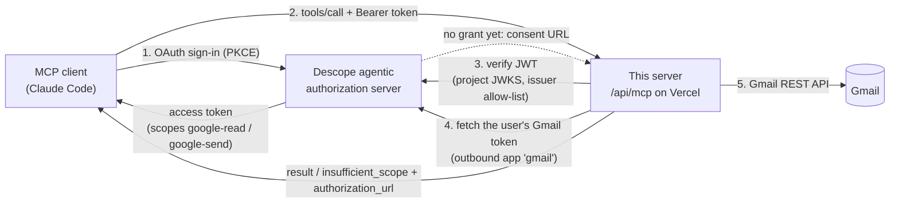

# Descope Gmail MCP Server

A remote MCP server that lets an agent such as Claude Code read and send Gmail for the signed-in user. Descope stores the Gmail OAuth tokens, so the agent never sees them. The server runs as a Next.js app on Vercel and is built on [`mcp-handler`](https://github.com/vercel/mcp-handler).

It was adapted from Descope's `examples/nextjs-vercel-mcp-server` sample, for the Enron dedup pipeline in the parent folder of this repo ([README](../README.md)). That pipeline uses it to send duplicate notices.

## Architecture



## Tools

| Tool | Arguments | Returns |
|---|---|---|
| `read_gmail_inbox` | `max_results` (1–20) | `{"emails":[{"from","subject","preview"}]}` |
| `send_gmail_email` | `to`, `subject`, `body`, optional `references` (sets References and In-Reply-To) | `{"status":"sent","gmail_message_id","thread_id"}` |

If the user hasn't granted the Gmail scope yet, a tool returns an error result: `{"error":"insufficient_scope","authorization_url":...}`. Open the URL, approve, then retry. Gmail API failures come back as `Error: Gmail API <status>: <message>`. Header values containing CR/LF are rejected.

## Setup

1. **Google Cloud:**
   - Create an OAuth client of type *Web application*.
   - Add the redirect URI `https://api.descope.com/v1/outbound/oauth/callback`.
   - Enable the **Gmail API**.
   - If the consent screen is in Testing, add yourself as a test user.
2. **Descope → Agentic Identity Hub:**
   - **Connection** `gmail`: use your Google client ID and secret, with scopes `gmail.readonly` and `gmail.send`. Set its access rules so user tokens may fetch their own tokens; otherwise you get error `E113301`.
   - **MCP Server**: add scopes `google-read` → gmail.readonly and `google-send` → gmail.send.
3. **Environment:** copy `.env.example` to `.env.local`, then fill in `NEXT_PUBLIC_DESCOPE_PROJECT_ID` and `DESCOPE_MCP_SERVER_ID`. `PUBLIC_BASE_URL` is optional on Vercel.
4. **Run and deploy:**
   ```bash
   pnpm install
   pnpm dev                # http://localhost:3000/api/mcp
   npx vercel --prod       # set the same env vars in the Vercel project
   ```
5. **Connect Claude Code:**
   ```bash
   claude mcp add --transport http --scope user descope-gmail https://<your-app>.vercel.app/api/mcp
   ```
   Then run `/mcp` → descope-gmail → authenticate.

## Changes from the Descope sample

- **Token verification:** `@descope/node-sdk`'s `validateSession()` rejects tokens from the agentic authorization server, because their issuer ends in the MCP server ID rather than the project ID. The server now verifies the RS256 signature itself with WebCrypto against the project JWKS. It checks `exp`/`nbf` and accepts only the project issuer or the agentic issuer (`app/api/[transport]/route.ts`).
- **User identity:** comes from the Bearer token (`extra.authInfo`) instead of the sample's `_meta`.
- **`references` argument:** added to `send_gmail_email`, plus the CR/LF header guard.
- **Error reporting:** Gmail and Descope errors are now returned, not swallowed. Previously an API error showed up as an empty inbox.
- **No per-email approval:** the Enchanted Link approval step from the blog version is not implemented.
